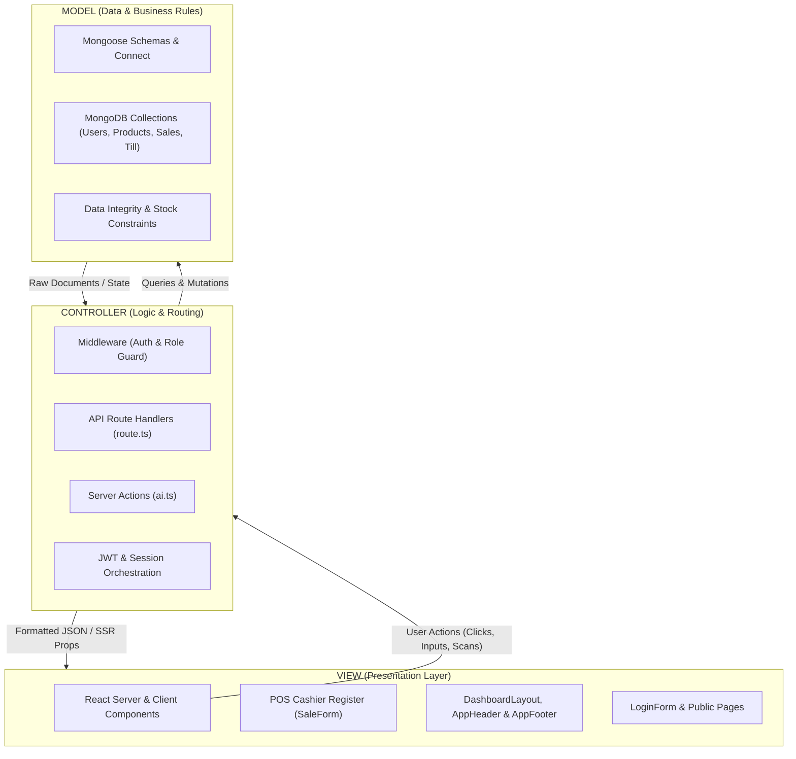

# INVENSMART AI — Architecture Explained (MVC Model)

This document provides a comprehensive breakdown of how the **INVENSMART AI** application is architected according to the **MVC (Model-View-Controller)** design pattern.

---

---

## 1. The MODEL (M) — Data & Business State

The **Model** represents the application’s business data, schema definitions, validation constraints, and database connection. In this app, MongoDB and Mongoose serve as the Model layer.

### Core Files:
- **Database Connection**: `src/db/index.ts`
  - Establishes and caches the singleton connection to MongoDB Atlas.
- **Data Schemas & Domain Rules**: `src/db/schema.ts`
  
| Model | Purpose & Data Attributes | Business Rules & Constraints |
| :--- | :--- | :--- |
| **`User`** | `username`, `passwordHash`, `role`, `isActive` | Roles strictly limited to `Administrator`, `Inventory Manager`, or `Cashier`. Passwords securely hashed with `bcrypt`. |
| **`Product`** | `name`, `sku`, `barcode`, `sellingPrice`, `purchasePrice`, `stock`, `minimumStock` | Ensures SKU uniqueness; tracks real-time inventory quantity; triggers low-stock alerts when `stock <= minimumStock`. |
| **`Category`** | `name`, `description` | Grouping products (Laptops, Printers, Hardware, etc.). |
| **`Sale`** | `saleNumber`, `cashierId`, `items`, `subtotal`, `discount`, `total`, `paymentMethod` | Records finalized POS orders (Cash, MTN MoMo, Orange, Card, Transfer) and deducts inventory. |
| **`TillSession`** | `cashierId`, `openingFloat`, `closingCash`, `expectedCash`, `status` | Enforces shift management; ensures cashiers balance their drawer before signing out. |
| **`StockMovement`**| `productId`, `type` (IN/OUT/ADJUSTMENT), `quantity`, `reference` | Immutable audit trail of every unit received or issued. |
| **`AuditLog`** | `userId`, `action`, `details`, `timestamp` | Security log tracking logins, price edits, and role changes. |

---

## 2. The VIEW (V) — User Interface & Presentation

The **View** is everything the user sees and interacts with on screen. It is built using React components (combining fast Next.js Server Components for initial rendering with Client Components for dynamic interactivity) and styled with CSS variables supporting **Dark & Light Mode**.

### Core Files:
- **Global Layout & Frame**:
  - `src/app/layout.tsx`: Root layout with `ThemeProvider.tsx`.
  - `src/components/DashboardLayout.tsx`: Dynamic sidebar showing only the navigation links permitted for the user's role.
  - `src/components/AppHeader.tsx`: Sticky topbar showing live breadcrumbs, clock, global search (`Ctrl+K`), system notifications, and theme toggle.
  - `src/components/AppFooter.tsx`: System telemetry bar showing live uptime (99.98%), DB health, and branch info.

- **Role-Specific Views**:
  - **Cashier POS**: `src/app/cashier/sales/SaleForm.tsx`
    - Touch/click-friendly category cards.
    - Real-time cart calculator with instant tax/discount calculation.
    - Quick-tender currency notes and cash change calculator.
    - Thermal receipt preview modal ready for printing.
  - **Inventory Workspace**:
    - Product catalogs, stock reception forms, shelf barcode label generators, and stock adjustment tables.
    - `src/app/inventory-manager/ai/AIChatPanel.tsx`: Conversational analytics interface to ask AI about inventory reorder points.
  - **Authentication**:
    - `src/app/page.tsx` and `src/components/LoginForm.tsx`: Clean, centered card for username/password sign-in.

---

## 3. The CONTROLLER (C) — Routing, Logic & Orchestration

In a Next.js App Router architecture, the **Controller** role is shared between **Middleware**, **API Route Handlers (`route.ts`)**, and **Server Actions**. The Controller receives incoming user requests from the View, verifies permissions, performs business computations, calls the Model to read or write data, and returns the response.

### Core Files:
- **Route Guard Controller (Middleware)**:
  - Redirects unauthenticated users to `/login`.
  - Ensures a Cashier cannot navigate into `/admin` or `/inventory-manager`, while Inventory Managers and Administrators inherit Cashier permissions (enabling them to open/close tills, execute sales, and process refunds).

- **Authentication Controller**:
  - `src/app/api/auth/login/route.ts`:
    1. Receives `{ username, password }` from the View.
    2. Queries the `User` Model.
    3. Verifies `bcrypt` password hash.
    4. Issues a signed, secure HTTP-only session cookie.
    5. Returns success to the View to trigger automatic redirection.

- **POS Transaction Controller**:
  - `src/app/api/sales/route.ts`:
    1. Receives cart items, cashier ID, and payment method from the View.
    2. Validates that all requested products exist in the `Product` Model and have adequate `stock`.
    3. Atomically reduces the product stock in the database.
    4. Creates a new `Sale` document and a corresponding `StockMovement` entry.
    5. Returns the finalized sale record to the View for printing.

- **AI Prediction Controller**:
  - `src/app/actions/ai.ts`:
    1. Extracts current inventory counts and minimum stock thresholds from the `Product` Model.
    2. Constructs an enterprise prompt and queries Google Gemini.
    3. Parses the AI response and sends actionable inventory suggestions back to the View.

---

## 4. End-to-End Walkthrough: Processing a Sale

Here is how the 3 layers work together during a single cashier sale:

1. **User interaction (VIEW)**: 
   The Cashier clicks on the "Laptops" category card in `SaleForm.tsx`, selects an item, and clicks **"Confirm & Print Receipt"**.
2. **Dispatch to Controller (CONTROLLER)**: 
   The View sends an HTTP `POST` request with the cart payload to `/api/sales`.
3. **Business Validation (CONTROLLER $\rightarrow$ MODEL)**:
   The controller accesses `src/db/schema.ts` through Mongoose:
   - Verifies the cashier's till session is currently **OPEN**.
   - Checks that inventory is available: `Product.stock >= requestedQuantity`.
4. **State Persistence (MODEL)**:
   The database executes an atomic transaction:
   - Updates `Product.stock = Product.stock - quantity`.
   - Inserts the new `Sale` record with payment metadata.
   - Logs an `INVENTORY_DEDUCTION` in `StockMovement`.
5. **View Update (CONTROLLER $\rightarrow$ VIEW)**:
   The controller responds with `HTTP 200` and the generated sale number (`REC-2026-XXXX`). 
   The View plays a subtle checkout audio cue, clears the cart, and displays the **Thermal Print Receipt Modal**.

---

## 5. Summary Architecture Matrix

| MVC Component | Technologies Used | Responsibility in this Application |
| :--- | :--- | :--- |
| **Model** | MongoDB, Mongoose, Schemas, bcrypt | Defines tables/collections, validation rules, stock counters, relationships, and encryption. |
| **View** | Next.js Components, TSX, CSS Variables, Lucide Icons | Renders responsive pages, dark/light theme, POS registers, forms, cards, and modal dialogs. |
| **Controller** | Next.js API Routes, Middleware, Server Actions, Jose (JWT) | Validates input, guards role routes, verifies passwords, updates stock, and bridges AI models with data. |
