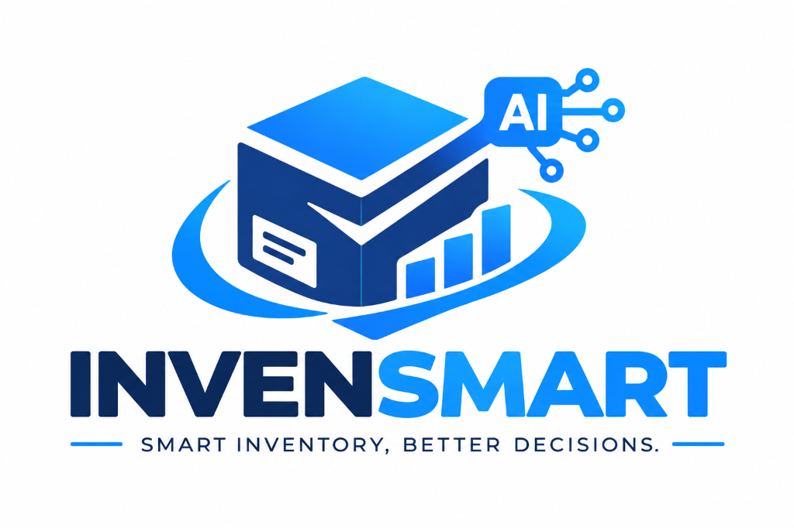
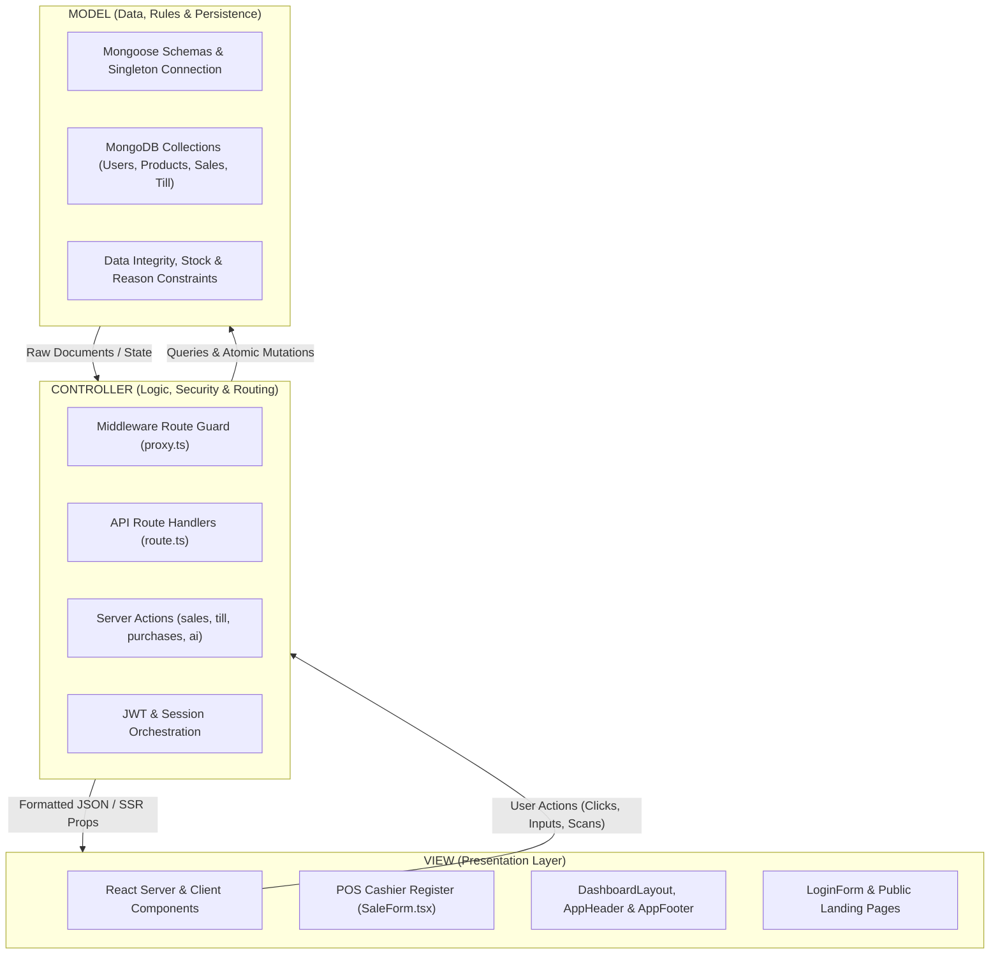

<div align="center">

  

  # INVENSMART AI
  ### Enterprise AI-Powered Inventory Intelligence & Point-of-Sale (POS) Platform

  [](https://nextjs.org/)
  [](https://react.dev/)
  [](https://www.typescriptlang.org/)
  [](https://www.mongodb.com/)
  [](https://ai.google.dev/)
  [](https://vitest.dev/)

  <p align="center">
    <strong>Smart Inventory, Better Decisions.</strong> Engineered for commercial retail and warehouse operations, featuring automated till sessions, real-time stock issuance, printable receipts, and an AI co-pilot.
  </p>

</div>

---

## 📌 Table of Contents

- [Overview](#-overview)
- [Key Features](#-key-features)
- [Architecture & Tech Stack](#-architecture--tech-stack)
- [Architecture Explained: The MVC Model](#-architecture-explained-the-mvc-model)
  - [1. The MODEL (M) — Data & Business State](#1-the-model-m--data--business-state)
  - [2. The VIEW (V) — User Interface & Presentation](#2-the-view-v--user-interface--presentation)
  - [3. The CONTROLLER (C) — Routing, Logic & Orchestration](#3-the-controller-c--routing-logic--orchestration)
  - [4. End-to-End Walkthrough: Processing a Sale](#4-end-to-end-walkthrough-processing-a-sale)
  - [5. Summary Architecture Matrix](#5-summary-architecture-matrix)
- [Getting Started](#-getting-started)
  - [Prerequisites](#prerequisites)
  - [Installation](#installation)
  - [Environment Variables](#environment-variables)
  - [Database Seeding](#database-seeding)
  - [Demo Accounts](#demo-accounts)
- [Project Directory Structure](#-project-directory-structure)
- [Role-Based Access Control (RBAC)](#-role-based-access-control-rbac)
- [Available Scripts](#-available-scripts)
- [Testing Suite](#-testing-suite)
- [Documentation & Deep Dives](#-documentation--deep-dives)

---

## 🚀 Overview

**INVENSMART AI** is a full-stack, enterprise-grade inventory management and point-of-sale system tailored for retail and warehouse operations. It eliminates manual discrepancies, stockouts, and till reconciliation delays with real-time stock movement audits, cash shift tracking, and predictive inventory analytics powered by Google Gemini AI.

---

## ✨ Key Features

### 🛒 Point of Sale (POS) & Cashier Register
- **Interactive POS Terminal:** Touch- and click-friendly product category layout with live cart calculations.
- **Tender & Change Calculator:** Multi-currency / quick-tender cash calculation with support for Cash, Mobile Money (MTN MoMo, Orange Money), and Bank Transfers.
- **Till Shift Controls:** Opening float entry, real-time sales reconciliation, discrepancy calculations (surpluses/shortages), and worker session assignments.
- **Thermal Receipts:** Ready-to-print formatted receipt previews with business header, NIU, itemized breakdown, and tax summaries.
- **Audio Feedback:** Synthesized Web Audio API beeps for product barcode scans and transaction success.

### 📦 Warehouse & Inventory Intelligence
- **Comprehensive Catalog:** Pre-seeded with 100 popular electronic products spanning Laptops, Phones, Storage, Audio, and Accessories.
- **Warehouse Purchase Orders (PO):** Multi-item order creation, supplier status tracking (`Pending`, `Received`, `Cancelled`), and automated stock increment upon delivery.
- **Internal Issuance Flow:** Move stock safely between central storage and sales counters with authorized issuer and receiver logging.
- **Multi-Factor Stock Adjustments:** Instant manual count updates with mandatory reason codes (Breakage, Expiry, Audit Count, Theft) generating immutable `StockMovement` records.
- **Shelf Barcode & QR Label Printing Studio:** In-browser designer and batch printer for machine-scannable Code 128 linear barcodes, 2D QR codes, and shelf price tags with live zoom preview and presets (50x30mm, 38x25mm, A4 24-label sheets, 58mm/80mm thermal rolls).
- **Automated Stock Alerts:** Real-time visual warnings for items below minimum stock threshold (`<= minimumStock`) or out of stock.

### 🤖 Google Gemini AI Co-Pilot
- **Conversational Analytics:** Ask questions about inventory health, fast-moving items, and reorder urgency via natural language.
- **Automated Reorder Forecasting:** AI analysis predicting product runout dates based on current sales velocity and stock level ratios.
- **Model Fallback Cascade:** Resilient multi-tier query handler with fallback options across `gemini-2.5-flash`, `gemini-2.0-flash`, and `gemini-1.5-flash`.

### 🛡️ Security, Audit & UX
- **Strict RBAC Middleware:** Server-side route guards enforcing permission boundaries across Administrators, Inventory Managers, and Cashiers.
- **Comprehensive Audit Trail:** Logs all critical actions (logins, price modifications, stock adjustments, till sessions).
- **Global Quick Search (`Ctrl + K`):** Instant modal search across products, navigation routes, and common actions.
- **Keyboard Shortcuts (`?`):** Modal overview of POS and navigation accelerator keys.
- **Dark & Light Mode:** System-adaptive theme engine with high-contrast accessibility.

---

## 🛠️ Architecture & Tech Stack

| Domain | Technology | Description |
| :--- | :--- | :--- |
| **Framework** | Next.js 16.2.6 (Turbopack) | Modern React server components, streaming SSR, and edge middleware |
| **Frontend Library**| React 19.2.6, TypeScript 5.9 | Component UI, strict types, modern hooks |
| **Database** | MongoDB & Mongoose 9.9.4 | NoSQL document storage with atomic mutations and schema validations |
| **Styling** | Vanilla CSS Tokens + Tailwind 4 | Responsive design system, CSS variables, Dark & Light modes |
| **Authentication** | `bcrypt` + `jose` (JWT) | Secure salt-hashed passwords and signed HTTP-only cookies |
| **AI Integration** | Google Gemini 2.4 / Pro | Demand forecasting, anomaly alerts, natural language inventory chat |
| **Charts** | Recharts 3.10 | Live sales charts, categorical distributions, inventory trends |
| **Testing** | Vitest 5.0, Supertest | Server action unit testing, schema validation, and RBAC matrix |

---

## 🏛️ Architecture Explained: The MVC Model

The application follows the **Model-View-Controller (MVC)** architectural pattern to maintain a clean separation of concerns, high maintainability, and enterprise security.



---

### 1. The MODEL (M) — Data & Business State

The **Model** represents the application's business data, schema definitions, validation constraints, and database connections (`src/db/index.ts` and `src/db/schema.ts`).

| Model | Purpose & Data Attributes | Business Rules & Constraints |
| :--- | :--- | :--- |
| **`User`** | `username`, `passwordHash`, `role`, `isActive` | Roles strictly limited to `Administrator`, `Inventory Manager`, or `Cashier`. Passwords securely hashed with `bcrypt`. |
| **`Product`** | `name`, `sku`, `barcode`, `sellingPrice`, `purchasePrice`, `stock`, `minimumStock` | Ensures SKU uniqueness; tracks real-time inventory quantity; triggers low-stock alerts when `stock <= minimumStock`. |
| **`Category`** | `name`, `description` | Grouping products (Laptops, Printers, Hardware, etc.). |
| **`Sale`** | `saleNumber`, `cashierId`, `items`, `subtotal`, `discount`, `total`, `paymentMethod` | Records finalized POS orders (Cash, MTN MoMo, Orange, Card, Transfer) and deducts inventory. |
| **`TillSession`** | `cashierId`, `openingFloat`, `closingCash`, `expectedCash`, `status` | Enforces shift management; ensures cashiers balance their drawer before signing out. |
| **`StockMovement`**| `productId`, `type` (IN/OUT/ADJUSTMENT), `quantity`, `reference` | Immutable audit trail of every unit received or issued. |
| **`AuditLog`** | `userId`, `action`, `details`, `timestamp` | Security log tracking logins, price edits, and role changes. |

---

### 2. The VIEW (V) — User Interface & Presentation

The **View** represents everything the user interacts with on screen. Built using React components (combining fast Next.js Server Components with dynamic Client Components) styled with CSS variables supporting **Dark & Light Mode**.

- **Global Layout & Frame:**
  - `src/app/layout.tsx`: Root layout with `ThemeProvider.tsx`.
  - `src/components/DashboardLayout.tsx`: Dynamic sidebar showing only navigation links permitted for the user's role.
  - `src/components/AppHeader.tsx`: Sticky topbar showing live breadcrumbs, clock, global search (`Ctrl+K`), system notifications, and theme toggle.
  - `src/components/AppFooter.tsx`: Telemetry bar showing live uptime (99.98%), DB health, and branch info.

- **Role-Specific Workspaces:**
  - **Cashier POS (`src/app/cashier/sales/SaleForm.tsx`):**
    - Touch/click-friendly category cards.
    - Real-time cart calculator with instant tax/discount computation.
    - Quick-tender currency notes and cash change calculator.
    - Thermal receipt preview modal ready for printing.
  - **Inventory Workspace (`src/app/inventory-manager/`):**
    - Product catalogs, stock reception forms, shelf barcode label generators, and stock adjustment tables.
    - `src/app/inventory-manager/ai/AIChatPanel.tsx`: Conversational analytics interface to ask AI about inventory reorder points.
  - **Authentication Gateway (`src/app/page.tsx` & `src/components/LoginForm.tsx`):**
    - Clean, centered card for username/password sign-in.

---

### 3. The CONTROLLER (C) — Routing, Logic & Orchestration

The **Controller** role is shared between **Middleware**, **API Route Handlers (`route.ts`)**, and **Server Actions**. The Controller receives incoming user actions from the View, verifies permissions, performs business computations, calls the Model to read or write data, and returns the response.

- **Route Guard Controller (Middleware — `src/proxy.ts`):**
  - Redirects unauthenticated users to `/login`.
  - Ensures a Cashier cannot navigate into `/admin` or `/inventory-manager`, while Inventory Managers and Administrators inherit Cashier permissions (enabling them to open/close tills, execute sales, and process refunds).

- **Authentication Controller (`src/app/api/auth/login/route.ts`):**
  1. Receives `{ username, password }` from the View.
  2. Queries the `User` Model.
  3. Verifies `bcrypt` password hash.
  4. Issues a signed, secure HTTP-only session cookie.
  5. Returns success to the View to trigger automatic redirection.

- **POS Transaction Controller (`src/app/actions/sales.ts`):**
  1. Receives cart items, cashier ID, and payment method from the View.
  2. Validates that all requested products exist in the `Product` Model and have adequate `stock`.
  3. Atomically reduces the product stock in the database.
  4. Creates a new `Sale` document and a corresponding `StockMovement` entry.
  5. Returns the finalized sale record to the View for printing.

- **AI Prediction Controller (`src/app/actions/ai.ts`):**
  1. Extracts current inventory counts and minimum stock thresholds from the `Product` Model.
  2. Constructs an enterprise prompt and queries Google Gemini.
  3. Parses the AI response and sends actionable inventory suggestions back to the View.

---

### 4. End-to-End Walkthrough: Processing a Sale

Here is how the 3 layers work together during a single cashier sale:

1. **User Interaction (VIEW):** 
   The Cashier clicks on the "Laptops" category card in `SaleForm.tsx`, selects an item, and clicks **"Confirm & Print Receipt"**.
2. **Dispatch to Controller (CONTROLLER):** 
   The View sends an execution request with the cart payload to the Server Action / route handler.
3. **Business Validation (CONTROLLER $\rightarrow$ MODEL):**
   The controller accesses `src/db/schema.ts` through Mongoose:
   - Verifies the cashier's till session is currently **OPEN**.
   - Checks that inventory is available: `Product.stock >= requestedQuantity`.
4. **State Persistence (MODEL):**
   The database executes an atomic transaction:
   - Updates `Product.stock = Product.stock - quantity`.
   - Inserts the new `Sale` record with payment metadata.
   - Logs an `INVENTORY_DEDUCTION` in `StockMovement`.
5. **View Update (CONTROLLER $\rightarrow$ VIEW):**
   The controller responds with `HTTP 200` and the generated sale number (`REC-2026-XXXX`). 
   The View plays a subtle checkout audio cue, clears the cart, and displays the **Thermal Print Receipt Modal**.

---

### 5. Summary Architecture Matrix

| MVC Component | Technologies Used | Responsibility in this Application |
| :--- | :--- | :--- |
| **Model** | MongoDB, Mongoose, Schemas, bcrypt | Defines tables/collections, validation rules, stock counters, relationships, and encryption. |
| **View** | Next.js Components, TSX, CSS Variables, Lucide Icons | Renders responsive pages, dark/light theme, POS registers, forms, cards, and modal dialogs. |
| **Controller** | Next.js API Routes, Middleware, Server Actions, Jose (JWT) | Validates input, guards role routes, verifies passwords, updates stock, and bridges AI models with data. |

---

## ⚡ Getting Started

### Prerequisites
- **Node.js** 18.18+ (Node 20+ recommended)
- **MongoDB** instance (Local MongoDB server or MongoDB Atlas URI)
- **Google Gemini API Key** (Get free key from [Google AI Studio](https://aistudio.google.com/))

### Installation

1. **Clone the repository:**
   ```bash
   git clone https://github.com/NkengH/INVENSYSTEMTSMART-.git
   cd ai-inventory-management-system
   ```

2. **Install dependencies:**
   ```bash
   npm install
   ```

### Environment Variables

Create a `.env` file in the project root:

```env
# MongoDB Connection String
MONGODB_URI=mongodb://127.0.0.1:27017/ai_inventory

# Secure JWT Secret for Session Cookies
JWT_SECRET=your_super_secret_jwt_key_at_least_32_characters

# Google Gemini AI API Key
GEMINI_API_KEY=your_google_gemini_api_key
```

### Database Seeding

Start the development server and visit the setup endpoint to automatically initialize demo users and **100 popular electronic products**:

```bash
npm run dev
```

Then visit in your browser:
```
http://localhost:3000/api/setup
```

*(You will receive a JSON confirmation showing created/verified users and catalog count).*

---

### 🔑 Demo Accounts

The setup endpoint automatically configures 3 distinct test accounts:

| Role | Username | Password | Default Redirect |
| :--- | :--- | :--- | :--- |
| **Administrator** | `admin` | `admin123` | `/admin` |
| **Inventory Manager** | `manager` | `manager123` | `/inventory-manager` |
| **Cashier** | `cashier` | `cashier123` | `/cashier` |

---

## 📁 Project Directory Structure

```
ai-inventory-management-system/
├── public/                     # Static media assets & logo (logo.png)
├── src/
│   ├── app/                    # Next.js App Router
│   │   ├── actions/            # Server Actions (ai, sales, till, products, adjustments...)
│   │   ├── admin/              # Administrator portal (users, audit logs, roles, AI)
│   │   ├── api/                # REST endpoints (auth, setup, notifications, health)
│   │   ├── cashier/            # POS workspace (sales register, till shifts, receipts)
│   │   ├── change-password/    # Forced / self-service password reset
│   │   ├── inventory-manager/  # Stock management (inventory, POs, issuance, reports)
│   │   ├── globals.css         # Global CSS variables, theme tokens, and component styles
│   │   ├── layout.tsx          # Root shell layout with ThemeProvider
│   │   └── page.tsx            # Login gateway page
│   ├── components/             # Reusable UI components & modals
│   │   ├── AppHeader.tsx       # Live status topbar, search, notifications, theme toggle
│   │   ├── AppFooter.tsx       # Telemetry bar, system status, keyboard shortcuts trigger
│   │   ├── BrandLogo.tsx       # Brand logo component
│   │   ├── DashboardLayout.tsx # Role-aware responsive navigation sidebar
│   │   ├── QuickSearchModal.tsx# Global Ctrl+K command palette
│   │   └── ShortcutsModal.tsx  # Keyboard shortcuts cheatsheet
│   ├── db/                     # Database connection & Mongoose schema models
│   ├── lib/                    # Security, auth, RBAC guards, audio & format utilities
│   ├── proxy.ts                # Next.js route guard middleware
│   ├── scripts/                # Database seed files (100 popular electronics)
│   └── tests/                  # Vitest automated test suites
├── EXPLAINED.md                # Detailed MVC architecture explanation
├── SYSTEM_ARCHITECTURE_SUMMARY.md # Deep technical architecture summary
├── package.json
├── tsconfig.json
└── vitest.config.mts           # Vitest configuration
```

---

## 🔒 Role-Based Access Control (RBAC)

| Capability / Resource | Administrator | Inventory Manager | Cashier |
| :--- | :---: | :---: | :---: |
| **Cashier POS & Register Checkout** | ✅ | ✅ | ✅ |
| **Open & Close Till Shifts** | ✅ | ✅ | ✅ |
| **Receipt History & Reprints** | ✅ | ✅ | ✅ |
| **View Inventory Levels** | ✅ | ✅ | ❌ |
| **Record Stock Adjustments** | ✅ | ✅ | ❌ |
| **Warehouse Purchase Orders (POs)** | ✅ | ✅ | ❌ |
| **Internal Stock Issuance** | ✅ | ✅ | ❌ |
| **AI Demand Forecasting & Chat** | ✅ | ✅ | ❌ |
| **Analytics & Financial Reports** | ✅ | ✅ | ❌ |
| **User & Staff Account Management** | ✅ | ❌ | ❌ |
| **Audit Logs & Security Inspection** | ✅ | ❌ | ❌ |

---

## 📜 Available Scripts

| Script | Command | Purpose |
| :--- | :--- | :--- |
| **Development** | `npm run dev` | Launches local server with Webpack at `http://localhost:3000` |
| **Build** | `npm run build` | Builds optimized production bundle |
| **Start** | `npm run start` | Runs the compiled production application |
| **Lint** | `npm run lint` | Runs ESLint over project source files |
| **Type Check** | `npm run typecheck` | Validates TypeScript types across the entire project |
| **Test** | `npm run test` | Runs all Vitest test suites once |
| **Test Verbose** | `npm run test:verbose` | Runs tests displaying individual suite results |
| **Test Watch** | `npm run test:watch` | Starts Vitest in interactive watch mode |
| **Test Coverage** | `npm run test:coverage` | Computes test coverage using `@vitest/coverage-v8` |

---

## 🧪 Testing Suite

Automated testing is powered by **Vitest** with in-memory database mocks and isolated unit tests.

Run tests:
```bash
npm run test
```

### Coverage Highlights:
- **`src/tests/actions/`**: Unit tests for Server Actions (Sales, Tills, Products, Purchases, Refunds, Adjustments, Notifications).
- **`src/tests/lib/`**: Role-based access control (`rbac.ts`), session verification, and currency formatting (`format.ts`).
- **`src/tests/db/`**: Schema validations, unique constraints, and schema hook tests.

---

## 📖 Documentation & Deep Dives

For further technical reading, refer to the included guides:
- [EXPLAINED.md](EXPLAINED.md) — Comprehensive breakdown of the project through the **Model-View-Controller (MVC)** design pattern.
- [SYSTEM_ARCHITECTURE_SUMMARY.md](SYSTEM_ARCHITECTURE_SUMMARY.md) — Deep architectural document covering database models, security, and component breakdown.

---

## 📄 License

This project is proprietary and built for enterprise commercial inventory and POS management. All rights reserved.
