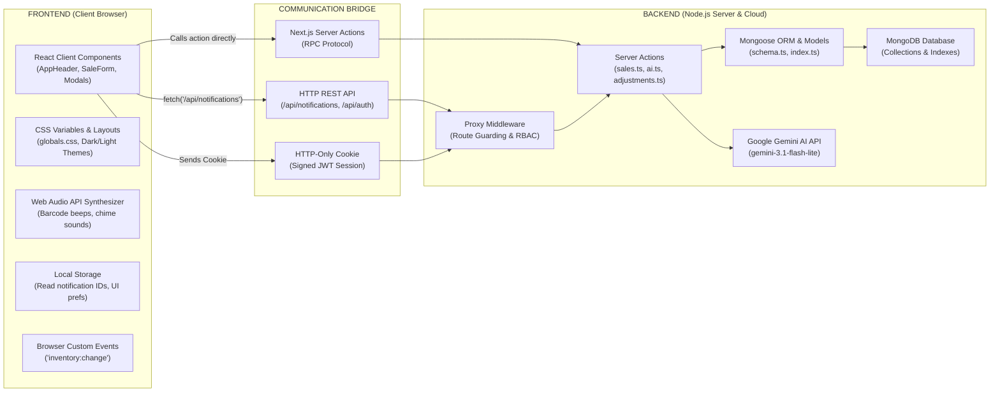

# INVENSMART AI — System Architecture, Tech Stack & File Guide

---

## 1. Executive Summary

**INVENSMART AI** is an enterprise-grade Inventory Intelligence and Point-of-Sale (POS) management application tailored for retail and warehouse operations (configured for Central African CFA currency). The system eliminates manual inventory discrepancies, stockouts, and reconciliation delays by providing:

1. **Role-Based Workspaces**: Tailored interfaces and permission boundaries for **Administrators**, **Inventory Managers**, and **Cashiers**.
2. **Point-of-Sale (POS) Engine**: Fast checkout register with barcode scanning audio feedback, split payments, multi-currency cash tender calculations, and printable receipts.
3. **Cashier Till & Shift Controls**: Shift opening floats, expected cash reconciliations, discrepancy detection (surpluses/shortages), and audit logs.
4. **Warehouse & Stock Tracking**: Real-time stock issuance, low-stock threshold monitoring, multi-factor warehouse adjustments, and suppliers purchase orders (POs).
5. **AI Inventory Co-Pilot**: Integrated with **Google Gemini AI** for demand forecasting, reorder anomaly detection, and natural language inventory Q&A.
6. **Live Notification Center**: Instant operational alerts (low stock, out-of-stock, till variances, sales completions) backed by auto-polling and cross-component custom events.

---

## 2. Directory & Key Files Breakdown

```
ai-inventory-management-system/
├── public/                     # Static assets (logo.png, icons)
├── src/
│   ├── app/                    # Next.js App Router (Pages, Routes, Layouts)
│   │   ├── actions/            # Backend: Next.js Server Actions
│   │   ├── admin/              # Frontend: Administrator Views
│   │   ├── api/                # Backend: REST/HTTP API Route Handlers
│   │   ├── cashier/            # Frontend: Cashier & POS Register Views
│   │   ├── change-password/    # Frontend: Forced Password Reset Flow
│   │   ├── inventory-manager/  # Frontend: Inventory & Warehouse Management Views
│   │   ├── globals.css         # Frontend: Global CSS Tokens, Theme & Layout Styles
│   │   ├── layout.tsx          # Frontend: Root HTML Shell with ThemeProvider
│   │   └── page.tsx            # Frontend: Landing & Authentication Gateway
│   ├── components/             # Frontend: Reusable Presentation & Modal Components
│   ├── db/                     # Backend: MongoDB Connection & Mongoose Schemas
│   ├── lib/                    # Shared / Backend: Security, Auth, RBAC & Utilities
│   ├── proxy.ts                # Backend: Edge Middleware & Session Route Guard
│   ├── scripts/                # Database Utilities (e.g. seed100Electronics.ts)
│   └── tests/                  # Automated Test Suite (Vitest + Testing Library)
├── .env                        # Environment Configuration (Mongo URI, JWT, Gemini API)
├── package.json                # Project Dependencies & NPM Scripts
├── tsconfig.json               # TypeScript Compiler Configuration
└── vitest.config.mts           # Vitest Test Runner Configuration
```

### Key Folders & Critical Files Explained

| Directory / File | Layer | Description & Role |
| :--- | :--- | :--- |
| **`src/app/actions/`** | Backend | **Server Actions** executed exclusively on the server. Directly mutates database state without exposing raw API endpoints. |
| ├── `ai.ts` | Backend | Orchestrates Google Gemini calls, builds compact prompt payloads, and handles model fallback cascades. |
| ├── `sales.ts` | Backend | Validates cart items, verifies open till sessions, deducts stock atomically, records sales, and generates receipts. |
| ├── `adjustments.ts` | Backend | Records inventory deductions/additions with mandatory reason codes and creates immutable `StockMovement` records. |
| ├── `till.ts` | Backend | Manages cashier opening drawer floats, reconciliation, and surplus/shortage discrepancy calculations. |
| ├── `purchases.ts` | Backend | Manages purchase order creation, cancellation, and receiving warehouse items into live stock. |
| ├── `notifications.ts` | Backend | Aggregates real-time notifications across stock, tills, movements, and sales. |
| **`src/app/api/`** | Backend | **Next.js Route Handlers** for standard HTTP clients and background synchronization. |
| ├── `notifications/route.ts` | Backend | `GET /api/notifications` with `Cache-Control: no-store` for 10-second client polling; `POST` for read tracking. |
| ├── `auth/login/route.ts` | Backend | Validates credentials against `bcrypt` hash and sets HTTP-only signed JWT session cookies. |
| **`src/components/`** | Frontend | **Reusable UI Components**. |
| ├── `AppHeader.tsx` | Frontend | Topbar containing live system clock, dynamic breadcrumbs, Ctrl+K search trigger, theme toggle, and live notification dropdown. |
| ├── `DashboardLayout.tsx` | Frontend | Responsive layout shell with dynamic role-filtered sidebar navigation. |
| ├── `LoginForm.tsx` | Frontend | Secure login form with validation, credential submission, and recovery modal. |
| ├── `StockAdjustmentModal.tsx` | Frontend | Modal dialog for warehouse stock adjustments with live stock previews. |
| **`src/db/`** | Backend | **Data Access Layer**. |
| ├── `index.ts` | Backend | Singleton connection manager caching Mongoose connection across hot-reloads. |
| ├── `schema.ts` | Backend | Mongoose models for `User`, `Product`, `Inventory`, `StockMovement`, `TillSession`, `Sale`, `Purchase`, `Notification`, and `AuditLog`. |
| **`src/lib/`** | Shared | **Core Business Helpers**. |
| ├── `auth.ts` | Backend | JWT generation, verification, and cookie extraction using `jose`. |
| ├── `rbac.ts` | Backend/Shared | Role-Based Access Control matrix (`Administrator`, `Inventory Manager`, `Cashier`). |
| ├── `sound.ts` | Frontend | Zero-dependency Web Audio API synthesizer for scanner beeps, sale success chimes, and alert tones. |
| ├── `format.ts` | Shared | Currency formatter (`formatCFA`) supporting African CFA format. |
| **`src/proxy.ts`** | Backend | Application gateway middleware guarding protected URLs, checking temporary passwords, and rejecting unauthorized roles. |

---

## 3. Frontend vs. Backend Differentiation



### Responsibilities Breakdown

| Characteristic | Frontend (Client-Side) | Backend (Server-Side) |
| :--- | :--- | :--- |
| **Where Code Runs** | User's Web Browser (Chrome, Firefox, Safari) | Node.js Server Environment |
| **Primary Directive** | Rendering UI, user input, visual feedback, accessibility | Business rules, security, database storage, external APIs |
| **Key Directives** | Starts with `"use client"` at top of file | Starts with `"use server"` or lives in `route.ts` / `proxy.ts` |
| **State Maintained** | React `useState`, DOM focus, modal visibility, audio context | Persistent database records, sessions, transaction logs |
| **Security Surface** | Publicly accessible code; cannot hold secret API keys | Secure environment; stores `JWT_SECRET` and `GEMINI_API_KEY` |

---

## 4. How Frontend and Backend Communicate

The application utilizes **three distinct communication patterns**:

### Pattern A: Next.js Server Actions (Remote Procedure Call)
The frontend calls an asynchronous TypeScript function as if it were local; Next.js translates this into a secured POST request behind the scenes.

**Real-world Example (`StockAdjustmentModal.tsx` $\rightarrow$ `adjustments.ts`):**

1. *Frontend* ([`StockAdjustmentModal.tsx`](file:///c:/Users/HIRO/Documents/ai-inventory-management-system/src/components/StockAdjustmentModal.tsx)):
   ```tsx
   // Client Component invokes backend Server Action directly
   const res = await adjustStock({
     productId: product.id,
     adjustmentType: "ADD",
     quantity: 10,
     reason: "AUDIT_DISCREPANCY",
   });

   // Immediately notifies other UI widgets via browser event
   window.dispatchEvent(new CustomEvent("inventory:change"));
   ```

2. *Backend* ([`src/app/actions/adjustments.ts`](file:///c:/Users/HIRO/Documents/ai-inventory-management-system/src/app/actions/adjustments.ts)):
   ```tsx
   "use server";
   export async function adjustStock(payload: AdjustStockPayload) {
     await connectToDatabase();
     const session = await getSession(); // Verifies JWT cookie
     if (!hasPermission(session.role, "inventory.manage")) {
       throw new Error("Unauthorized");
     }
     
     // Atomically updates Inventory collection & records StockMovement
     inv.quantity += payload.quantity;
     await inv.save();
     await StockMovement.create({ ... });

     revalidatePath("/inventory-manager/inventory");
     return { success: true, newQuantity: inv.quantity };
   }
   ```

---

### Pattern B: HTTP API Route Handlers & Auto-Polling
Used for continuous background synchronization without page reloading.

**Real-world Example ([`AppHeader.tsx`](file:///c:/Users/HIRO/Documents/ai-inventory-management-system/src/components/AppHeader.tsx) $\leftrightarrow$ [`src/app/api/notifications/route.ts`](file:///c:/Users/HIRO/Documents/ai-inventory-management-system/src/app/api/notifications/route.ts)):

1. *Frontend Polling & Event Listener*:
   ```tsx
   // AppHeader.tsx polls every 10 seconds or immediately on UI action events
   const fetchLiveNotifications = async () => {
     const res = await fetch("/api/notifications", { cache: "no-store" });
     const data = await res.json();
     if (data.success) {
       setNotifications(data.notifications);
     }
   };

   useEffect(() => {
     fetchLiveNotifications();
     const interval = setInterval(fetchLiveNotifications, 10000);
     window.addEventListener("inventory:change", fetchLiveNotifications);
     return () => {
       clearInterval(interval);
       window.removeEventListener("inventory:change", fetchLiveNotifications);
     };
   }, []);
   ```

2. *Backend Route Handler*:
   ```tsx
   // src/app/api/notifications/route.ts
   export async function GET() {
     const notifications = await getLiveNotifications();
     return NextResponse.json(
       { success: true, notifications },
       { headers: { "Cache-Control": "no-store, max-age=0" } }
     );
   }
   ```

---

### Pattern C: Edge Middleware & JWT Session Cookie
When navigating between pages, the browser sends the HTTP-only `session` cookie. [`src/proxy.ts`](file:///c:/Users/HIRO/Documents/ai-inventory-management-system/src/proxy.ts) intercepts the request before any HTML is generated:

```ts
// src/proxy.ts (Next.js Middleware)
export async function proxy(request: NextRequest) {
  const token = request.cookies.get("session")?.value;
  if (!token) return NextResponse.redirect(new URL("/", request.url));

  const verified = await jwtVerify(token, JWT_SECRET);
  const role = verified.payload.role;

  // Enforces role-based boundaries
  if (request.nextUrl.pathname.startsWith("/admin") && role !== "Administrator") {
    return NextResponse.redirect(new URL("/", request.url));
  }
  return NextResponse.next();
}
```

---

## 5. Programming Languages, Frameworks & Tooling

| Technology / Tool | Version | Purpose in this System | Why Chosen |
| :--- | :--- | :--- | :--- |
| **TypeScript** | `^5.9.3` | Primary language across entire frontend & backend | Guarantees strict type safety, prevents runtime null reference crashes in financial calculations, and shares models across layers. |
| **Next.js** | `16.2.6` | Full-stack framework (App Router) | Unifies React UI with server-side API routes and server actions in a single codebase with fast SSR (Server-Side Rendering). |
| **React & React-DOM** | `19.2.6` | Declarative UI library | State-driven user interfaces, instant reactivity, modal handling, and modern hooks (`useCallback`, `useMemo`, `useState`). |
| **MongoDB** | `v7.0+` | NoSQL Document Database | High performance for nested documents (sales with dynamic items, purchase orders, till logs) with schema flexibility. |
| **Mongoose** | `^9.9.4` | Object Data Modeling (ODM) library | Strict schema validation, connection pooling, pre-save hooks, and population of foreign references. |
| **Google Gemini AI SDK** (`@google/generative-ai`) | `^0.24.1` | Generative AI integration | Direct API client connecting to `gemini-3.1-flash-lite` for sub-second (~500ms) conversational inventory analytics and predictions. |
| **jose** | `^6.2.10` | Universal JSON Web Token (JWT) library | Standard-compliant, zero-dependency JWT signing and verification that runs efficiently in edge middleware environments. |
| **bcrypt** | `^6.0.0` | Password hashing library | Implements salted one-way cryptographic hashing for secure user password storage. |
| **Vanilla CSS + Variables** | CSS3 | System styling & theme engine | Eliminates CSS-in-JS runtime overhead; provides clean CSS custom properties (`--brand-600`, `--bg-card`) for instant dark/light mode toggling. |
| **Tailwind CSS & PostCSS** | `4.1.17` / `8.5.8` | Utility CSS preprocessing | Rapid component styling utilities and modern CSS compilation. |
| **Lucide React** | `^1.37.0` | Iconography library | Consistent, lightweight SVG icons across all buttons, navigation pills, and alert badges. |
| **Recharts** | `^3.10.1` | Analytics charting library | Renders reactive SVG graphs for sales trends, inventory turnover, and revenue charts. |
| **Vitest** | `^5.0.1` | Automated unit & integration testing | Ultra-fast native ESM test runner with in-memory MongoDB support (runs 154 tests in ~11 seconds). |
| **Node.js** | `v22 / v26` | Server runtime engine | Asynchronous non-blocking I/O runtime powering Next.js and API endpoints. |
